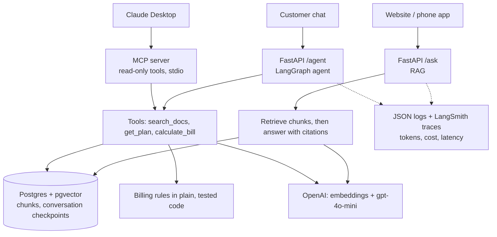
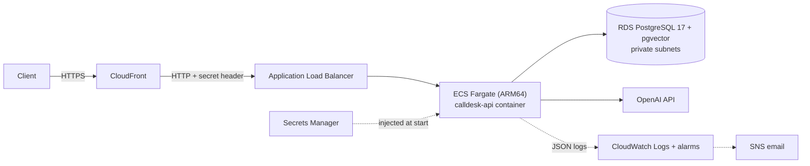

# Calldesk RAG + Agent: an LLMOps portfolio project

A production-style question-answering API and tool-using agent for **Calldesk**, an AI phone receptionist
for home-service businesses, built from scratch to learn LLM engineering end to end: RAG, embeddings,
vector search with pgvector, evaluation, observability, LangChain, LangGraph, MCP, Docker and CI.

> **Disclaimer:** this is a **personal learning project**. I work as an engineer at Calldesk, but this is
> **not the Calldesk product**: it is not built, run or endorsed by Calldesk, LLC, and it uses **no internal
> code, data or systems**. The knowledge base in `rag/data/` is my own short summary of information that was
> publicly available on calldesk.app in October 2026, and may be out of date. No real bookings, messages or
> payments are ever made: all "write" tools are simulated.

## Architecture



**One question through `/ask`:** API key and input checked → question embedded → 4 nearest chunks from
pgvector (HNSW, cosine) → chunks below a relevance threshold are dropped, and off-topic questions are refused
**without calling GPT** → GPT answers only from the chunks, with citations → one JSON log line with tokens,
cost, latency and the chunks used.

**`/agent`:** a LangGraph `model ⇄ tools` loop. The model chooses tools; **pricing is done by code**
(`calculate_bill`), never by the model. Conversations are stored as Postgres checkpoints per `thread_id`
(UUIDs scoped to the API key), so memory survives restarts and works across several containers.

## Results

**Evaluation**: 32 hand-written questions (25 answerable, 7 that must be refused, including a prompt
injection), with retrieval, answer and refusal measured separately.

| Version | Answer accuracy | Refusal accuracy | What changed |
|---|---|---|---|
| Baseline | 84% | 100% | — |
| v2 | 92% | 100% | Self-contained chunks, clearer test question, balanced prompt |
| v3 | **100%** | **100%** | Contextual chunk headers, clearer headings |

100% means this eval set is saturated, not that the system is perfect (see limitations).

**Production numbers** (gpt-4o-mini, from request logs): p50 **1.6 s**, p95 **2.4 s**, about
**$0.00007 per answer** (about 13,000 answers per $1). Off-topic questions are refused in about 260 ms for
about $0.0000002, because GPT is never called.

**Model comparison** (same RAG, same eval, 2 runs each):

| Model | Answers | p95 latency | Cost per 1,000 answers |
|---|---|---|---|
| **gpt-4o-mini (chosen)** | 100% / 100% | 2.3 s | **$0.07** |
| gpt-4.1-nano | 84% / 84% | 1.8 s | $0.05 |
| gpt-5-nano | 100% / 100% | **9.0 s** | $0.26 |
| gpt-5.6-luna | 100%* | 3.2 s | $0.12 |
| gpt-5.4-mini | 100% / 100% | 2.0 s | $0.45 |

The cheapest model per token (gpt-5-nano) cost **3.6× more per answer** because of reasoning tokens, and
its 9-second p95 would be unacceptable for a phone receptionist. *Luna's refusals were correct but more
nuanced than my exact-match checker accepted: a test limitation, not a model failure.

## Things I learned by measuring

- **Data quality beats prompt tweaks.** The biggest accuracy gains came from making each chunk stand on its
  own, not from rewording the prompt.
- **Coarse metrics hide failures.** File-level retrieval said 100% while the right *paragraph* was missing.
- **Put business logic in code.** An agent answered "$999" instead of "$1,199" in 3/3 runs when doing the
  maths itself. A tested `calculate_bill` tool fixed it in 3/3 runs.
- **LLM-as-judge needs checking too.** A run-time claim checker hallucinated and produced false alarms. On a
  labelled set, no judge design was reliable enough to block answers, so it should flag, not block.
- **Multi-agent wasn't worth it here.** A supervisor with 3 specialists cost about 3× the model calls and 4×
  the latency of one agent with 5 tools, without fixing the real problem (incomplete lookups).
- **Warm up what you actually call.** Warming a different OpenAI endpoint didn't help; warming the embeddings
  endpoint cut first-request retrieval from up to 4.6 s to about 0.3 s.
- **Framework churn is real.** I hit four breaking changes or deprecations along the way (`langchain-community`,
  `InMemoryChatMessageHistory`, the MCP SDK 2.x rename, `langchain-mcp-adapters` vs MCP 2.x), so versions
  are pinned and the core RAG uses the plain OpenAI SDK.

## Run it

Requires Docker and an OpenAI API key.

```bash
cp .env.example .env            # then fill in OPENAI_API_KEY and APP_API_KEY
docker compose up -d --build    # Postgres + pgvector, and the API on :8000
docker compose run --rm app python rag/ingest.py
```

```bash
curl -s -X POST localhost:8000/ask -H "X-API-Key: $APP_API_KEY" -H "Content-Type: application/json" \
  -d '{"question": "How much do extra minutes cost?"}'

curl -s -X POST localhost:8000/agent -H "X-API-Key: $APP_API_KEY" -H "Content-Type: application/json" \
  -d '{"message": "What would 900 extra minutes on Growth cost per month?"}'
```

Interactive API docs: http://localhost:8000/docs

**Tests and eval:** `uv run pytest` (45 offline tests: fake keys, no network) and
`uv run rag/eval.py --min-accuracy=95` (the 32-question eval, about $0.002).
CI runs the tests on every push, and the eval gate on pushes to `main`.

## Deployed on AWS (Terraform, `infra/`)



- **36 resources**, region `us-west-1`: VPC (public + private subnets, **no NAT gateway**), RDS (private,
  encrypted), ECR (immutable tags, scan on push), ECS Fargate ARM64 (0.5 vCPU / 1 GB), ALB, CloudFront (HTTPS),
  3 Secrets Manager secrets, CloudWatch logs (7 days) and 3 alarms (5xx errors, p95 latency, no healthy host).
- **Layered security:** the ALB only accepts CloudFront's IP ranges **and** a secret header; the app only accepts
  the ALB; the database only accepts the app. Secrets are injected at start-up; the OpenAI key is put into
  Secrets Manager by hand, so it never appears in code or Terraform state.
- **Rate limiting:** 30 requests per minute per API key (429 + `Retry-After`).
- **Live results:** the same 32-question eval run **against the deployed HTTPS API**: **100% retrieval, answers
  and refusals**. CloudWatch Logs Insights: `/ask` p50 **1.19 s**, p95 **2.44 s**, **$0.000072** per answer.
- **Cost:** about **$1.80/day** while running (mostly the ALB and RDS). `terraform destroy` removes everything
  (no final snapshot, ECR force-delete, secrets with no recovery window), so it costs $0 between demos.

Deploy it yourself: see the comments in `infra/` and `infra/terraform.tfvars.example`; the outputs print the
commands for setting the OpenAI secret, running ingest as a one-off ECS task, and fetching the API key.

## Project layout

| Path | What it is |
|---|---|
| `rag/api.py` | FastAPI: `/ask`, `/agent`, `/health`, API-key auth, validation, startup warm-up |
| `rag/ask.py`, `search.py`, `ingest.py`, `db.py` | The hand-written RAG pipeline (plain OpenAI SDK + psycopg + pgvector) |
| `rag/agent_service.py` | The production LangGraph agent with Postgres-checkpointed memory |
| `rag/billing.py` | Calldesk pricing rules as tested code |
| `rag/eval.py`, `eval_questions.json` | The eval suite and CI gate |
| `rag/mcp_server.py` | The MCP server (read-only tools, a resource and a prompt) for Claude Desktop |
| `rag/lc_*.py`, `graph_*.py`, `agent_scratch.py`, `judge.py`, `compare_models.py` | Learning lessons: LangChain, LangGraph (memory, human approval, multi-agent), agents from scratch, LLM-judge measurement, model comparison |
| `tests/` | Unit and API tests (OpenAI and the database are mocked) |

## Limitations and next steps

- **The eval set is small and saturated:** it needs more, harder questions, a held-out set, and LLM-as-judge
  scoring instead of substring matching.
- **Rate limiting is in-process**, so with several containers each counts separately; a shared store
  (ElastiCache/Redis) would make it exact.
- **No custom domain:** CloudFront terminates HTTPS, but CloudFront → ALB is plain HTTP (protected by the
  prefix list and secret header). A domain + ACM certificate on the ALB would encrypt that hop too.
- **Single-AZ database and one container:** cheap, but not highly available. Production would use RDS Multi-AZ
  and 2+ tasks across zones (the rate limiter would then need the shared store above).
- **Deploys are manual** (`terraform apply` + `docker push`). Next: GitHub Actions with AWS OIDC.
- **Image scan:** one HIGH finding in Debian's zlib, with no fixed package yet and versions that don't match the
  CVE's affected range (likely a false positive). Accepted and documented; rebuild when Debian ships an update.
- **The knowledge base is a manual snapshot**, not synced from the source.
- **Write tools** (book job, SMS, refund) are only demonstrated locally behind human approval
  (`rag/graph_approval.py`); they are not exposed by the API.
- **MCP runs locally over stdio.** A remote MCP endpoint would need OAuth and rate limits first.
- **Privacy:** production use would need retention and deletion policies for logs, conversation
  checkpoints and customer memories.
